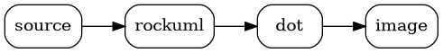
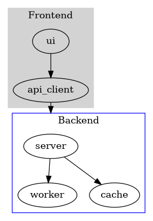

```rockuml tldr
@startuml
title What rockuml does with @startdot
participant "graph.puml" as Source
participant rockuml
participant "Graphviz\ndot" as Dot
Source -> rockuml : digraph G { … }
rockuml -> rockuml : preprocess
rockuml -> Dot : the graph, -Tsvg or -Tpng
Dot --> rockuml : the image
rockuml -> rockuml : write graph.svg
@enduml
```



Between `@startdot` and `@enddot` goes a graph in Graphviz's own language. rockuml does not lay it out itself: like PlantUML, it hands the graph to the Graphviz `dot` program installed on your machine and writes what `dot` makes of it. Everything Graphviz knows works, from shapes, colours and clusters to HTML labels, and the image is exactly Graphviz's.

That needs Graphviz, so these diagrams are drawn by the `rockuml` command line and its server only. The browser build cannot run programs: it reports `@startdot` as not available, which is why the examples on this page show their source only; the diagram above shows what happens. Every other diagram type needs no Graphviz at all.

## Finding `dot`

rockuml looks for `dot` the way PlantUML does, and takes the first of:

1. the path given with `--dot-path` (or PlantUML's `-graphvizdot`), or with `-DGRAPHVIZ_DOT=...`;
2. the `GRAPHVIZ_DOT` environment variable;
3. a `dot` on the `PATH`;
4. the places installers put it: `/usr/local/bin/dot`, `/opt/homebrew/bin/dot`, `/opt/homebrew/opt/graphviz/bin/dot` and `/usr/bin/dot`, or on Windows a `Graphviz*\bin\dot.exe` in a folder of `C:\`.

```bash
rockuml --svg --dot-path /opt/graphviz/bin/dot graph.puml
GRAPHVIZ_DOT=/opt/graphviz/bin/dot rockuml graph.puml
```

## The graph

The first line after `@startdot` must open the graph on its own: `digraph name {`, `graph {`, `strict digraph "a name" {` and the like, with nothing after the brace. Anything else, such as `digraph { a -> b }` on one line, is a syntax error, as in PlantUML. The lines up to `@enddot` go to `dot` as they are, after the preprocessor has run, so `!define`, variables, procedures and `!include` work in a graph too:

```plantuml
@startdot
!$colour = "orange"
!procedure $node($name)
  $name [style=filled, fillcolor=$colour];
!endprocedure
digraph preprocessed {
  $node(first)
  $node(second)
  first -> second;
}
@enddot
```



Clusters, ranks and every attribute Graphviz has work the same way:



## Output formats and errors

PNG and SVG images are `dot`'s `-Tpng` and `-Tsvg` output, unchanged; they carry no copy of the source. Graphviz has no `debug` or `svg-deterministic` format, so those report that Graphviz crashed, as PlantUML usually does (it sometimes writes `dot`'s complaint about the format instead).

What `dot` writes to its error stream ends up in the image file, as in PlantUML: a warning comes before the SVG, and a graph with a syntax error gives a file holding `dot`'s error message. When rockuml finds no `dot`, the image says "There is an issue with your Dot/Graphviz installation"; when `dot` cannot be run, "GraphViz has crashed". A `dot` still running 30 seconds after it has finished writing is stopped and counts as crashed; `--graphviz-timeout <seconds>` changes the wait. Both images make the command line exit with status `200` (but for `-f null`, which writes an empty file whatever happens), and the server answer with `503`.

Under the `INSECURE` and `INTERNET_WITH_DOTSVG` security profiles (`PLANTUML_SECURITY_PROFILE`), PlantUML 1.2026.8 does not run `dot` for SVG images and writes a short SVG saying the feature has been suppressed; rockuml does the same.
