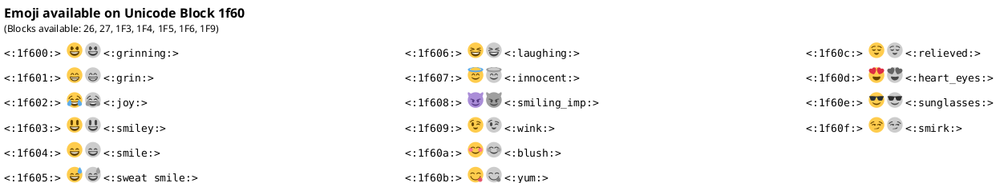

```rockuml tldr
@startuml
help themes
@enduml
```

A few keywords draw a reference card instead of a diagram: what the language knows, the icons and sprites it has built in, and the emoji it can draw. Each card is a diagram of its own; most take a single line between `@startuml` and `@enduml`.

## Help

`help keywords`, `help types`, `help colors`, `help themes` and `help fonts` list the words of the language, the types of element, the colour names, the [themes](docs/themes) and the fonts. Several requests in one diagram are drawn one after the other.

```rockuml
@startuml
help types
help colors
@enduml
```

PlantUML lists the fonts installed on the machine it runs on. rockuml lists the fonts it always has: Java's logical fonts (`SansSerif`, `Serif`, `Monospaced`, `Dialog`, `DialogInput`), the embedded Liberation fonts and the Windows families they stand in for. Fonts added with `--font` or `ROCKUML_FONTS` work in diagrams but are not listed.

## Open Iconic icons

`openiconic` and a name draws that [Open Iconic](https://github.com/iconic/open-iconic) icon on its own, in black, at its size of 8 pixels. `listopeniconic` draws all 223 icons with their names, in seven columns, the names to write in `<&name>` (see [Sprites, images and icons](docs/sprites)).

```rockuml
@startuml
openiconic heart
@enduml
```

```rockuml
@startuml
listopeniconic
@enduml
```

## Emoji

`emoji` lists the emoji of the Unicode block `26`, each with its code, its picture in colour and in black, and its shortcut. `emoji` and the start of a code lists another block, such as `emoji 1f60`; it lists shortcuts too, so `emoji smi` shows the emoji whose shortcuts start with `smi`. Emoji are part of the `rockuml` binary, and left out of the browser build, so this example only renders on your machine:



## Sprites

`listsprites` on its own lists the built-in ArchiMate sprites, the names to write in `<$archimate/name>`, in four columns.

```rockuml
@startuml
listsprites
@enduml
```

After sprite definitions, `listsprites` draws the sprites the diagram defines instead, by name, in rows; `title` and the other common commands work.

```rockuml
@startuml
title The sprites of this diagram
sprite $dot <svg viewBox="0 0 10 10"><circle cx="5" cy="5" r="4" fill="#3070C0"/></svg>
sprite $grid {
  FFFFFFFF
  F000000F
  F0F00F0F
  F000000F
  FFFFFFFF
}
listsprites
@enduml
```

## Definitions

Between `@startdef(id=name)` and `@enddef` go definitions that `!includedef` reads from another file (see the [preprocessor](docs/preprocessor)). Drawn on its own, such a block shows its start line only, as PlantUML does.

```rockuml
@startdef(id=greetings)
!definelong HELLO(name)
Alice -> name : hello
!enddefinelong
@enddef
```
