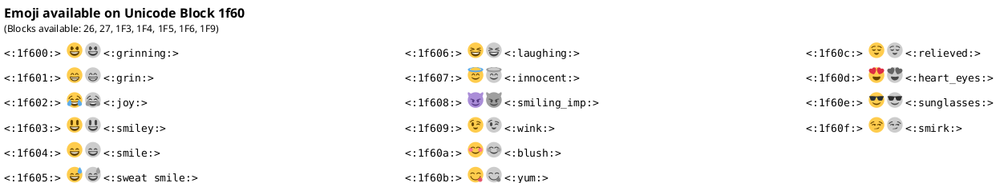

```rockuml tldr
@startuml
colors Orange
@enduml
```

A few keywords draw a reference card instead of a diagram of yours: the colours you can name, the skin parameters, the fonts at hand, the version and license of rockuml, what the language knows, the icons and sprites it has built in, and the emoji it can draw. They are handy to look something up without leaving your editor. Most cards are the whole diagram, a single line between `@startuml` and `@enduml`: with any other line beside the keyword, rockuml reads the lines as a diagram of their own.

## The welcome screen

An empty diagram, `@startuml` followed directly by `@enduml`, shows how to start, as in PlantUML.

```rockuml
@startuml
@enduml
```

A blank line between the two is no longer empty: it is an error, "Empty description".

## Colours

`colors` draws every colour name rockuml knows, on a swatch of that colour, black or white whichever reads better. Any of these names can stand wherever a colour goes, in any case: `#LightBlue`, `#lightblue`.

```rockuml
@startuml
colors
@enduml
```

Followed by a colour, a name or a hex value, `colors` draws the named colours closest to it on hexagons around it: a quick way to pick a neighbouring shade.

```rockuml
@startuml
colors #8AF
@enduml
```

The keyword may also be written `color`; it is case-sensitive, so `Colors` is an error.

## Skin parameters

`skinparameters` lists the names `skinparam` knows, in five columns, as PlantUML lists them. Many of them are covered by [style sheets](docs/styling) today.

```rockuml
@startuml
skinparameters
@enduml
```

## Fonts

`listfonts` lists the font families diagrams can name with `<font:…>` or `skinparam defaultFontName`, each with a sample in itself. Give your own sample text after the keyword.

```rockuml
@startuml
listfonts The quick brown fox
@enduml
```

PlantUML lists the fonts installed on the machine. rockuml never reads the machine's fonts, so that a diagram looks the same everywhere: it lists the Liberation fonts it embeds, under their own names and under the names of the Windows fonts they stand in for (Arial, Times New Roman and Courier New), Java's logical fonts (`SansSerif`, `Serif`, `Monospaced`, `Dialog` and `DialogInput`), and every font you added with `--font` or `ROCKUML_FONTS` (see the [command line](docs/cli)). The fonts you add are used, and listed, in the formats that draw text with fonts: PNG and SVG.

## Version and authors

`version` tells which rockuml draws the diagram, which PlantUML release it reproduces, its license and how it lays out graphs.

```rockuml
@startuml
version
@enduml
```

PlantUML's card also tells the Java runtime, the operating system, the memory and the Graphviz installation it uses. rockuml runs without Java and lays out its diagrams itself, so it tells none of those; only `@startdot` runs Graphviz's `dot` (see [Graphviz sources](docs/dot)). `testdot`, which in PlantUML checks the Graphviz installation, says the same.

`authors` (or `about`) tells where rockuml comes from: a port of PlantUML, by Arnaud Roques and its contributors.

`stdlib` lists the libraries of the [standard library](docs/preprocessor) rockuml embeds, with their versions and where they come from, as PlantUML does. The browser build leaves the standard library out, so the list is empty there.

The `keygen`, `keyimport`, `keycheck` and `keydistributor` lines are recognised and reported as not ported. PlantUML draws cards for them that request, import or check a license key for its professional edition; rockuml has no license keys.

## License

`license` tells rockuml's license, in the layout of PlantUML's card: the GNU Lesser General Public License, version 3 or later, like the PlantUML edition it ports; the Eclipse Public License for its layout code, ported from Graphviz; the licenses of the fonts, icons, sprites, themes and emoji it carries; and that the images you make belong to you.

```rockuml
@startuml
license
@enduml
```

## Help

`help keywords`, `help types`, `help colors`, `help themes` and `help fonts` list the words of the language, the types of element, the colour names, the [themes](docs/themes) and the fonts. Several requests in one diagram are drawn one after the other.

```rockuml
@startuml
help types
help colors
@enduml
```

`help fonts` lists the same fonts as `listfonts`: Java's logical fonts (`SansSerif`, `Serif`, `Monospaced`, `Dialog`, `DialogInput`), the embedded Liberation fonts and the Windows families they stand in for, and the fonts added with `--font` or `ROCKUML_FONTS`, where PlantUML lists the fonts installed on the machine it runs on.

## Open Iconic icons

`openiconic` and a name draws that [Open Iconic](https://github.com/iconic/open-iconic) icon on its own, in black, at its size of 8 pixels. `listopeniconic` draws all 223 icons with their names, in seven columns, the names to write in `<&name>` (see [Sprites, images and icons](docs/sprites)).

```rockuml
@startuml
openiconic heart
@enduml
```

```rockuml
@startuml
listopeniconic
@enduml
```

## Emoji

`emoji` lists the emoji of the Unicode block `26`, each with its code, its picture in colour and in black, and its shortcut. `emoji` and the start of a code lists another block, such as `emoji 1f60`; it lists shortcuts too, so `emoji smi` shows the emoji whose shortcuts start with `smi`. Emoji are part of the `rockuml` binary, and left out of the browser build, so this example only renders on your machine:



## Sprites

`listsprites` on its own lists the built-in ArchiMate sprites, the names to write in `<$archimate/name>`, in four columns.

```rockuml
@startuml
listsprites
@enduml
```

After sprite definitions, `listsprites` draws the sprites the diagram defines instead, by name, in rows; `title` and the other common commands work.

```rockuml
@startuml
title The sprites of this diagram
sprite $dot <svg viewBox="0 0 10 10"><circle cx="5" cy="5" r="4" fill="#3070C0"/></svg>
sprite $grid {
  FFFFFFFF
  F000000F
  F0F00F0F
  F000000F
  FFFFFFFF
}
listsprites
@enduml
```

## Definitions

Between `@startdef(id=name)` and `@enddef` go definitions that `!includedef` reads from another file (see the [preprocessor](docs/preprocessor)). Drawn on its own, such a block shows its start line only, as PlantUML does.

```rockuml
@startdef(id=greetings)
!definelong HELLO(name)
Alice -> name : hello
!enddefinelong
@enddef
```
